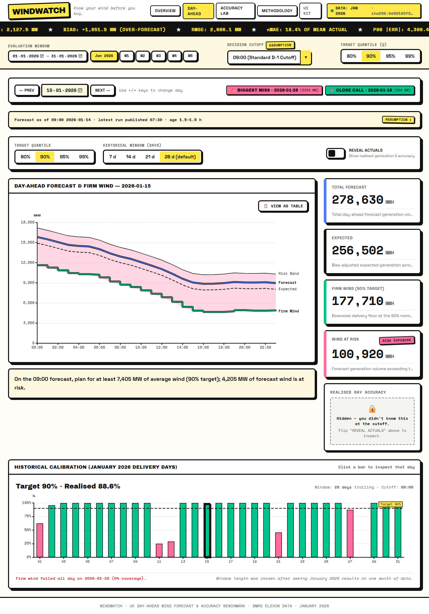
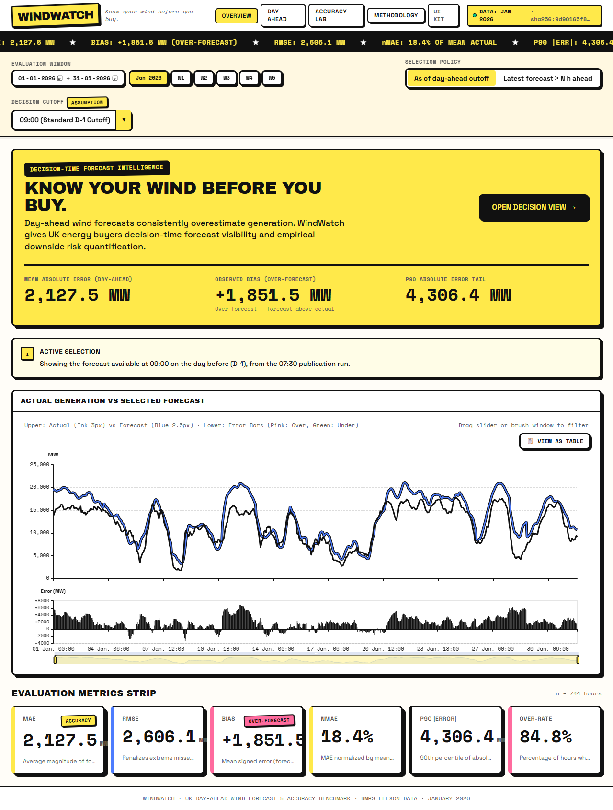
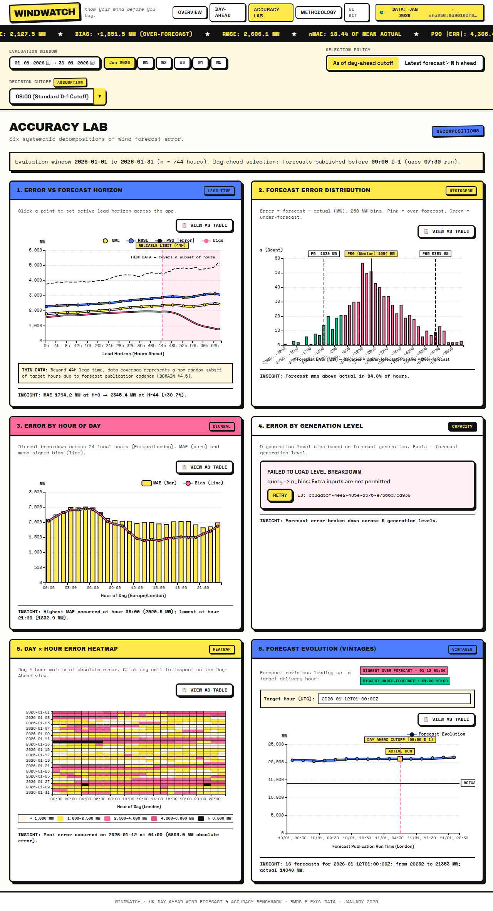
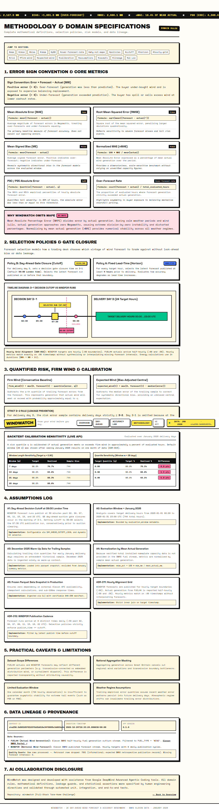
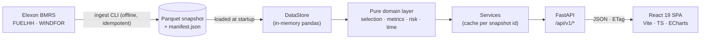

<div align="center">

# WINDWATCH

### _Know your wind before you buy._

A decision-support web app for a UK energy utility's **day-ahead power buying desk** — it shows the wind-generation forecast **as it stood when the buyer had to decide**, and puts **hard numbers on how wrong those forecasts tend to be**.


**🔗 Live app:** `<LIVE_URL>` · **🎥 Demo video:** `<VIDEO_URL>`

</div>

---

## Contents

1. [What it does](#what-it-does)
2. [Screenshots](#screenshots)
3. [The problem, in plain words](#the-problem-in-plain-words)
4. [Results at a glance](#results-at-a-glance-january-2026)
5. [How it works](#how-it-works)
6. [Quick start](#quick-start)
7. [Repository map](#repository-map)
8. [API overview](#api-overview)
9. [Testing & quality gates](#testing--quality-gates)
10. [Data & reproducibility](#data--reproducibility)
11. [Assumptions & limitations](#assumptions--limitations)
12. [Deployment](#deployment)
13. [Documentation index](#documentation-index)
14. [AI usage disclosure](#ai-usage-disclosure)
15. [Time spent](#time-spent)
16. [License](#license)

---

## What it does

The client buys electricity on the **GB day-ahead market**. Purchases for delivery day **D** must be made on **D-1**, _before_ anyone knows how much wind will blow, so the buying team leans on **wind forecasts**. The more wind they trust, the less thermal power they buy — and the more exposed they are if the forecast was too high.

WindWatch answers two questions, using national-level wind data from Elexon BMRS only:

1. **What was the latest wind forecast available at decision time?** → the **Day-ahead view**, for any January 2026 delivery day.
2. **How accurate have those forecasts been, quantitatively?** → **Overview** KPIs and the **Accuracy Lab** (error vs. forecast lead time, distribution, hour of day, generation level, day × hour heatmap, forecast evolution for a single hour).

On top of the raw forecast it builds a **risk-adjusted view**: an _expected_ (bias-adjusted) line, a **firm-wind** line (what you can lean on at a chosen target level) and an **at-risk band** — each computed _only_ from information available at the cutoff, and **backtested honestly** ("Target 90% · Realised 88.6%").

## Screenshots

| Day-ahead decision view                                           | Overview                                                          |
| ----------------------------------------------------------------- | ----------------------------------------------------------------- |
|  |        |
| **Accuracy Lab**                                                  | **Methodology**                                                   |
|    |  |

## The problem, in plain words

- **Actuals** — Elexon `FUELHH` (half-hourly generation by fuel), `fuelType = WIND`.
- **Forecasts** — Elexon `WINDFOR`: many forecasts exist for the same hour, each with a `publishTime`. The _horizon_ of a forecast is `startTime − publishTime`.
- **Which forecast "counts"?** That is the crux. WindWatch implements two explicit, leakage-tested policies:

| Policy      | Rule                                                                                                                                                        | Used for                                                        |
| ----------- | ----------------------------------------------------------------------------------------------------------------------------------------------------------- | --------------------------------------------------------------- |
| `day_ahead` | For delivery day D, take the **latest forecast published at or before the cutoff** (default **09:00 London on D-1**). Never backfill from a later forecast. | The headline decision view                                      |
| `lead_time` | Take the **latest forecast made at least _H_ hours before** the target hour.                                                                                | The interactive horizon slider and accuracy-vs-horizon analysis |

- **Error convention:** `error = forecast − actual` (MW). Positive = **over-forecast** (forecast above actual), the costly direction for a buyer.
- **Evaluation grid:** WINDFOR is **hourly**, FUELHH is **half-hourly** → metrics use the inner join on `:00` timestamps (**24 points per day, 744 for January**). Nothing is interpolated or forward-filled (ADR-011).
- **Scope:** national wind, Elexon only, purchase decisions for **January 2026** (a December 2025 warm-up exists so early-January risk estimates have a trailing sample).

## Results at a glance (January 2026)

Day-ahead policy, 09:00 London cutoff, 744 hourly periods, straight from `GET /api/v1/metrics/summary`:

| Metric                                             | Value                                                                          |
| -------------------------------------------------- | ------------------------------------------------------------------------------ |
| Bias (mean error)                                  | **+1,851.5 MW** (forecast above actual; ≈ 16 % of mean actual wind, 11,581 MW) |
| MAE                                                | **2,127.5 MW** (nMAE 18.4 % of mean actual)                                    |
| RMSE                                               | 2,606.1 MW                                                                     |
| P90 / P95 of \|error\|                             | 4,306 MW / 5,351 MW                                                            |
| Hours over-forecast                                | 84.8 %                                                                         |
| Correlation (forecast vs actual)                   | 0.928                                                                          |
| Firm-wind calibration (target 90 %, 28-day window) | **88.6 % realised** (one-sided: actual ≥ firm wind)                            |

> The bias is **reported, not explained**: the two datasets alone cannot say whether it comes from a definitional scope difference, curtailment, or genuine forecast bias (see `docs/DECISIONS.md`, ADR-013). On 28 Jan 2026 the firm-wind line failed all day (forecast ≈ 5.3 GW above actual on average) — the UI says so.

Numbers are computed from the committed snapshot; run `scripts/smoke_deployed.py <base_url>` to verify any deployment reproduces them.

## How it works



- **Pure domain layer** (`backend/app/domain`) — no I/O, no framework imports; where the rigour lives and where most tests are.
- **Thin API** — routers validate and delegate; services orchestrate and cache; RFC 7807 problem+json errors; unknown query params rejected; ETag/304; never `NaN` in JSON.
- **Frozen snapshot, not live calls** — deterministic demo, no runtime dependency on Elexon (ADR-001). Ingestion is a separate, idempotent CLI that writes Parquet plus a checksummed manifest.
- **Frontend** — server state in TanStack Query, filter state in Zustand **synced to the URL** (every view is a shareable link), charts are pure option builders fed by API data, types **generated from the OpenAPI schema**. Styled as **Neo-Brutalism** (3 px ink borders, hard zero-blur shadows, flat colour) with a WCAG contrast gate.

### Risk method (short version)

For delivery day D, error samples come from the **trailing delivery days ending D−2** (D−1 is incomplete at the cutoff — using it would be look-ahead). With `q` the target level:

- `firm_wind = max(0, forecast − Q_q(error))`
- `expected = max(0, forecast − median(error))`
- `at-risk band` between `firm_wind` and `max(0, forecast − Q_{1−q}(error))`

Default `q = 0.90`, window **28 days** (chosen _after_ seeing January results on one month of data — disclosed in the app and ADR-015).

## Quick start

### Option A — Docker (recommended)

```bash
cp .env.example .env            # Windows PowerShell: copy .env.example .env
docker compose up --build
```

Open **http://localhost:8080** · Swagger UI at **http://localhost:8080/api/docs**.
Stop with `docker compose down`.

### Option B — Local development

Prerequisites: **Python 3.12+**, **Node 22+**.

```bash
# 1) backend  (http://localhost:8000)
cd backend
python -m venv .venv
source .venv/bin/activate        # Windows: .venv\Scripts\activate
pip install -e ".[dev]"
uvicorn app.main:app --reload --port 8000

# 2) frontend (http://localhost:5173, proxies /api -> :8000)
cd frontend
npm ci
npm run dev
```

Shortcuts (same targets via `make` on macOS/Linux and `make.bat` on Windows):

```text
make dev          # backend + frontend
make test         # pytest + vitest
make lint         # ruff, mypy, eslint, tsc
make ingest       # rebuild the Parquet snapshot from Elexon
make openapi      # export frontend/src/api/openapi.json
make golden       # regenerate API golden files (review the diff!)
make docker-up    # docker compose up --build
```

### Handy URLs

| What                            | URL                                |
| ------------------------------- | ---------------------------------- |
| Day-ahead view for a given day  | `/day-ahead?d=2026-01-15`          |
| The biggest miss of the month   | `/day-ahead?d=2026-01-28`          |
| Accuracy Lab                    | `/accuracy`                        |
| Forecast evolution for one hour | `/accuracy?t=2026-01-12T01:00:00Z` |
| Methodology & assumptions       | `/methodology`                     |

## Repository map

```text
.
├── README.md                  # you are here
├── AGENTS.md                  # rules for AI coding agents working on this repo
├── LICENSE
├── .env.example               # all configuration knobs (copy to .env)
├── Makefile · make.bat        # task runner (macOS/Linux · Windows)
├── docker-compose.yml         # backend + nginx frontend, one command
├── vercel.json · requirements.txt · api/index.py   # Vercel deployment (serverless FastAPI)
├── .github/workflows/ci.yml   # lint · types · tests · e2e · docker
├── scripts/                   # Elexon probe, benchmarks, bias diagnostic, OpenAPI export, golden regen, smoke test
├── docs/                      # design docs, ADRs, calibration, data profile, screenshots (screens/), build prompts (prompts/)
├── backend/
│   ├── pyproject.toml · Dockerfile
│   ├── app/
│   │   ├── main.py · config.py · logging.py · errors.py · middleware.py
│   │   ├── api/v1/            # thin routers (no pandas)
│   │   ├── schemas/           # Pydantic request/response models (match docs/API.md)
│   │   ├── services/          # orchestration + per-snapshot caching
│   │   ├── domain/            # PURE logic: timeutil, selection, align, metrics, risk
│   │   ├── data/              # DataStore: loads the snapshot
│   │   └── ingest/            # Elexon client, normalise, validate, writer, CLI, profile
│   ├── data/snapshot/         # actuals.parquet · forecasts.parquet · manifest.json · profile.json
│   └── tests/
│       ├── unit/              # domain + ingestion tests
│       ├── api/               # contract, validation, status, no-NaN, real-snapshot smoke
│       └── fixtures/          # elexon_raw samples · golden JSON · snapshot_mini
└── frontend/
    ├── package.json · vite.config.ts · vitest.config.ts · playwright.config.ts · Dockerfile · nginx.conf
    ├── e2e/                   # Playwright specs (overview, day-ahead, accuracy, methodology)
    ├── scripts/               # contrast_check.mjs · check_bundle.js
    └── src/
        ├── api/               # OpenAPI schema + generated types, typed client, query hooks
        ├── store/ · lib/      # URL-synced filters · url-state, captions, insights, contrast
        ├── styles/            # design tokens (Neo-Brutalism)
        ├── components/ui/     # design-system primitives
        ├── components/shell/  # top bar, ticker, filter bar, error boundary
        ├── components/charts/ # <Chart> wrapper, ECharts setup, tooltip
        ├── charts/            # chart theme + pure option builders (builders/)
        ├── content/           # single source for Methodology text
        ├── pages/             # Overview · Day-ahead · Accuracy Lab · Methodology · UI kit
        └── tests/             # Vitest + Testing Library + axe
```

## API overview

Base path `/api/v1` · full contract in [`docs/API.md`](docs/API.md) · interactive docs at `/api/docs`.

| Endpoint                                                         | Purpose                                                                                          |
| ---------------------------------------------------------------- | ------------------------------------------------------------------------------------------------ |
| `GET /health` · `GET /ready`                                     | liveness · readiness                                                                             |
| `GET /meta`                                                      | snapshot id, coverage, defaults, `max_horizon_hours`, `reliable_horizon_hours`, quality counters |
| `GET /series`                                                    | actual vs. selected forecast, hourly, with errors                                                |
| `GET /day-ahead/{date}`                                          | the decision view: forecast, expected, firm wind, band, actuals, accuracy                        |
| `GET /day-ahead/calibration`                                     | backtest of the risk line over a range of days                                                   |
| `GET /metrics/summary`                                           | MAE, RMSE, bias, P90/P95, nMAE, over-forecast rate, extremes, coverage                           |
| `GET /metrics/by-horizon`                                        | accuracy vs. lead time, with `n` and `coverage_pct` per horizon                                  |
| `GET /metrics/by-hour` · `by-level` · `distribution` · `heatmap` | the Accuracy Lab slices                                                                          |
| `GET /vintages`                                                  | every forecast ever published for one target hour                                                |

Conventions: ISO-8601 UTC timestamps, units in field names (`_mw`, `_h`, `_pct`), `error_mw = forecast_mw − actual_mw`, `null` (never `NaN`) for undefined values, `application/problem+json` errors with `request_id`, `ETag` + `Cache-Control`.

## Testing & quality gates

```bash
make test                       # backend (pytest) + frontend (vitest)
cd backend && pytest --cov=app  # backend with coverage
cd frontend && npm run test:coverage
cd frontend && npm run e2e      # Playwright journeys (needs backend running)
cd frontend && npm run check:bundle
node frontend/scripts/contrast_check.mjs
```

What is verified, and why it matters:

- **Leakage tests (the important ones):** property-based tests prove the day-ahead selection never uses a forecast published after the cutoff and never backfills; risk samples never include D−1 or later; an API-level test shows that changing future actuals does not move the firm-wind numbers.
- **Mutation sanity checks:** deliberately breaking key rules (error sign, `>=H`→`>H`, cutoff +1 h, leaking D−1) makes named tests fail.
- **Cross-validation:** the domain engine reproduces the independently computed numbers from the ingestion profile exactly.
- **Contract tests:** golden JSON per endpoint, 422/404/503 problem+json cases, ETag/304, no `NaN`/`Infinity` in any response.
- **Edge cases:** DST days (23/25 hourly periods), empty inputs, zero mean actual, tied bins, missing hours.
- **Performance budgets:** `scripts/bench_api.py` checks every endpoint against the budgets in `docs/SYSTEM_DESIGN.md` §5.
- **Frontend:** URL-state round-trips, keyboard-accessible slider, MSW-mocked page tests, axe accessibility checks, a contrast audit that computes WCAG ratios for every colour pair, a bundle-size guard (entry < 350 KB gzip, ECharts lazy-loaded).
- **CI** (`.github/workflows/ci.yml`): ruff, mypy (strict on `domain/`), pytest with coverage gate, snapshot-checksum guard, OpenAPI and generated-type drift guards, frontend lint/type/test/build, Playwright e2e, Docker build + smoke test.

## Data & reproducibility

- **Sources:** Elexon Insights/BMRS `FUELHH` (WIND) and `WINDFOR`, base URL `https://data.elexon.co.uk/bmrs/api/v1`.
- **Snapshot:** `backend/data/snapshot/` holds the Parquet files and a `manifest.json` (source params, row counts, SHA-256 per file, quality counters, `snapshot_id`). A test fails if the files and manifest disagree.
- **Rebuild:** `make ingest` (7-day chunks, bounded concurrency, retry with backoff, fails loudly rather than writing a partial snapshot). Two consecutive runs produce identical checksums.
- **Windows used:** actuals 2025-12-01 → 2026-01-31; WINDFOR publications from 2025-11-28 (forecasts reach ~66 h ahead, so early-December targets need late-November runs).
- **Observed data facts** (probed against the live API, see ADR-002/011/012): WINDFOR is hourly; ~21 % of raw rows are "retrocasts" (published after their target hour) and are dropped; publications are irregular (every 2–4 h at `:30` past 02, 04, 07, 09, 11, 15, 18, 22 UTC).

## Assumptions & limitations

| #   | Assumption / limit                                        | Notes                                                                                                                               |
| --- | --------------------------------------------------------- | ----------------------------------------------------------------------------------------------------------------------------------- |
| A1  | Day-ahead cutoff = **09:00 London on D-1**                | Configurable. No gate-closure time was verified. Any cutoff in [07:30, 09:30) selects the 07:30 run; ≥ 09:30 selects the 09:30 run. |
| A2  | "Decisions in January 2026" = delivery days 1–31 Jan 2026 | December 2025 data is used only as warm-up for risk samples.                                                                        |
| A3  | Hourly evaluation grid                                    | WINDFOR is hourly; `:30` actuals are not used (ADR-011).                                                                            |
| A4  | nMAE normalised by **mean actual**                        | Installed capacity is not in scope data. No MAPE (explodes near zero wind).                                                         |
| A5  | Risk window = 28 days                                     | Chosen after seeing January 2026 results — in-sample on one month (ADR-015).                                                        |

Limitations to keep in mind: one month of data limits tail estimates; national aggregate only (no regional errors); the large positive bias is reported but its cause is **not** established; by-horizon metrics beyond `reliable_horizon_hours` cover a non-random subset of hours of the day; no demand or price data, so "wind at risk" is not yet a procurement number; no dark mode in v1.

## Deployment

- **Local / CI parity:** Docker (`backend` = FastAPI on `python:3.12-slim`, non-root, healthcheck; `frontend` = nginx serving the built SPA and proxying `/api/`).
- **Public demo:** Vercel, single project — static frontend plus FastAPI as a serverless function under `/api`, snapshot bundled with the function.
- **Smoke test any deployment:** `python scripts/smoke_deployed.py https://<your-url>` checks health, metadata, the January headline numbers and SPA deep links.

Live app: `<LIVE_URL>`

## AI usage disclosure

As required by the brief: this project was built **with AI assistance**. **Antigravity** (agentic coding IDE) and **Claude** (Anthropic) were used for planning documents, architecture, scaffolding and code generation. Domain definitions, analytical choices and assumptions were specified up front in `docs/`; generated code was checked against them with tests (including leakage, cross-validation and mutation checks), reviewed, and is understood by the author. Where AI-reported numbers disagreed with the data or each other, they were re-derived and corrected (see the commit history and `docs/DECISIONS.md`).

## License

MIT — see [`LICENSE`](LICENSE).
